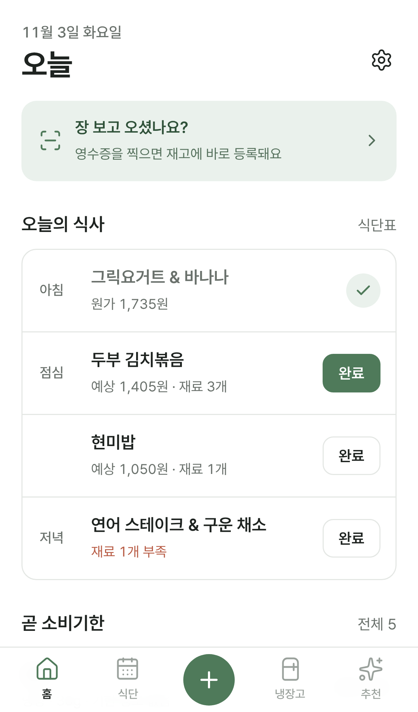
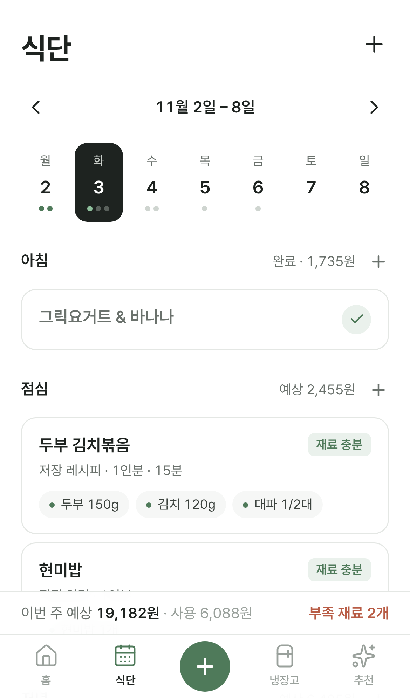
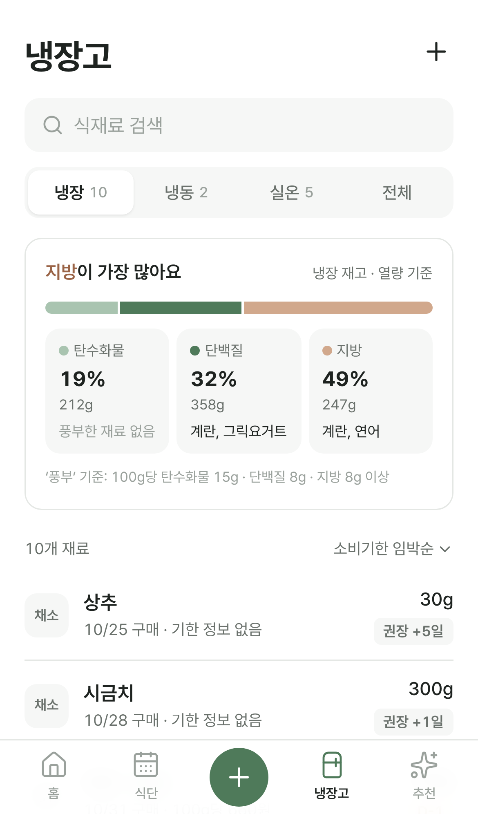
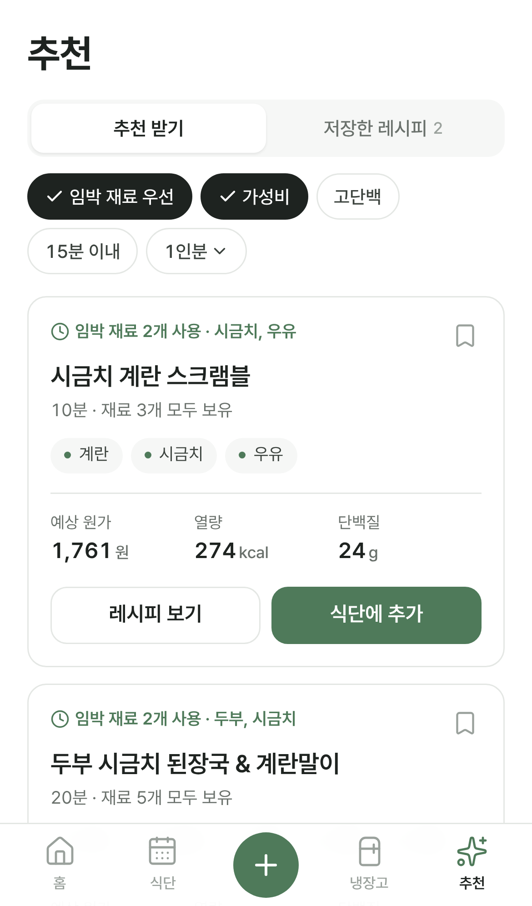

# MY KITCHEN

개인용 AI 식단 및 식재료 관리 PWA (Next.js · TypeScript · Tailwind CSS · Supabase · Vercel).

- 설계안: [docs/DESIGN.md](docs/DESIGN.md)
- 화면 시안: [docs/mockups](docs/mockups/README.md)

## 현재 상태 — Phase 1 (프론트엔드)

모바일 우선 UI와 하단 네비게이션을 구현했다. **AI API와 데이터베이스는 아직 연결하지 않았다.**
대신 오늘 날짜 기준으로 만든 예시 데이터를 브라우저 `localStorage`에 저장해, 모든 버튼이 실제처럼 동작한다.

| 홈 | 식단 | 냉장고 | 추천 |
|---|---|---|---|
|  |  |  |  |

## 실행 방법

Node.js 20.9 이상이 필요하다 (개발 환경: Node 22).

```bash
npm install
npm run dev          # http://localhost:3000
```

| 명령 | 설명 |
|---|---|
| `npm run dev` | 개발 서버 |
| `npm run build` | 프로덕션 빌드 |
| `npm run start` | 빌드 결과 실행 |
| `npm run lint` | ESLint |

**아이폰에서 확인하기**

1. PC와 아이폰을 같은 Wi‑Fi에 연결한다.
2. `npm run dev -- -H 0.0.0.0` 으로 실행하고, 아이폰 Safari에서 `http://<PC의 IP>:3000` 을 연다.
3. 공유 → "홈 화면에 추가"로 앱처럼 실행할 수 있다 (PWA 매니페스트·아이콘 포함).

데이터를 처음 상태로 돌리려면 홈 → 설정(톱니바퀴) → "예시 데이터로 초기화".

## 영수증 · 쿠팡 프레시 이미지 분석 설정

분석은 서버(`/api/analysis`)에서 Claude API로 처리한다. API 키는 서버 환경변수로만 쓰이고 브라우저에는 노출되지 않는다.

1. https://console.anthropic.com 에서 API 키를 만든다.
2. Vercel → 프로젝트 → **Settings → Environment Variables** 에 추가한다.

| 이름 | 값 | 필수 |
|---|---|---|
| `ANTHROPIC_API_KEY` | 발급받은 키 | 필수 |
| `APP_ACCESS_CODE` | 아무 비밀번호 | 권장 — 로그인 기능 전까지 남이 주소로 API를 호출해 요금이 나가는 것을 막는다. 앱에서 처음 한 번 입력 |
| `AI_MODEL_VISION` | 모델 ID | 선택 (기본 `claude-opus-5-5`) |

3. **Deployments → 최신 배포 → Redeploy** 해야 환경변수가 반영된다.

로컬에서는 `.env.example`을 `.env.local`로 복사해 값을 넣는다. 분석 1회마다 API 사용 요금이 발생한다.

**동작 방식**
- 브라우저에서 사진을 JPEG로 줄이고, 세로로 긴 캡처는 1000×1500 조각으로 겹쳐 나눠 보낸다 (최대 10조각).
- AI는 보이는 글자만 구조화해서 돌려준다 (상품명·수량·용량·금액·할인·보이는 소비기한). 계산은 하지 않는다.
- 단위 환산, 재료 매칭(학습한 별칭 → 이름 → 포함 관계), 주문 할인 배분, 단위 가격, 결제 금액 합계 검증은 `src/lib/receipt/draft.ts` 코드가 한다.
- 검수 화면에서 확인·수정 후 **승인해야만** 구매 내역 · 재고 로트 · 별칭이 한 번에 저장된다.
- API 키가 없으면 "예시로 체험"과 "직접 입력"으로 같은 검수·승인 흐름을 쓸 수 있다.

## 폴더 구조

```
src/
├─ app/                         # 라우트 (얇게 유지, 화면 컴포넌트만 렌더)
│  ├─ layout.tsx                # 폰트, 메타데이터, viewport-fit=cover, 전역 Provider
│  ├─ manifest.ts               # PWA 매니페스트
│  ├─ globals.css               # 디자인 토큰 (Tailwind v4 @theme)
│  ├─ (tabs)/                   # 하단 탭바가 있는 화면
│  │  ├─ page.tsx               # /           홈
│  │  ├─ planner/page.tsx       # /planner    주간 식단
│  │  ├─ scan/page.tsx          # /scan       추가(영수증 업로드)
│  │  ├─ fridge/page.tsx        # /fridge     냉장고
│  │  └─ recipes/page.tsx       # /recipes    AI 추천
│  └─ (detail)/                 # 뒤로가기 + 하단 고정 액션 바 화면
│     ├─ planner/[mealId]/      # 식사 상세 · 완료 · 이동 · 삭제
│     ├─ fridge/[ingredientId]/ # 식재료 상세 · 로트별 사용/이동/폐기
│     ├─ recipes/[recipeId]/    # 레시피 상세 · 인분 조절 · 식단 추가
│     └─ settings/              # 설정
├─ features/                    # 기능 모듈 (화면 + 시트)
│  ├─ home/                     # HomeScreen
│  ├─ meal-planner/             # PlannerScreen, MealDetailScreen, AddMealSheet,
│  │                            # AddToPlanSheet, CompleteMealSheet
│  ├─ inventory/                # FridgeScreen, IngredientDetailScreen, AddLotSheet, LotActionSheet
│  ├─ recipes/                  # RecipesScreen, RecipeDetailScreen, RecipeCard, recommend.ts
│  ├─ scan/                     # ScanScreen
│  └─ settings/                 # SettingsScreen
├─ components/
│  ├─ layout/                   # TabBar, ClientReady
│  └─ ui/                       # Button, Badge, Sheet, Toast, SegmentedControl, PageHeader,
│                               # QuantityField, misc(Card, Chip, EmptyState …)
└─ lib/
   ├─ domain/                   # ★ 순수 계산 로직 (AI 미사용) — 이후 단계에서 그대로 재사용
   │  ├─ types.ts               # DB 스키마와 1:1 대응하는 타입
   │  ├─ units.ts               # 단위 표시·단위 가격
   │  ├─ expiry.ts              # 소비기한 / 보관 권장기한 상태 (분리 표시)
   │  ├─ costing.ts             # FIFO 로트 배분, 예상 원가
   │  ├─ nutrition.ts           # 영양 합산 (정보 없음은 0이 아닌 제외 처리)
   │  └─ stock.ts               # 재고 요약, 식단별 부족분 예측
   ├─ store/                    # 클라이언트 목업 저장소 (reducer = 이후 DB RPC와 같은 규칙)
   ├─ mock/seed.ts              # 오늘 기준 예시 데이터
   └─ date.ts                   # Asia/Seoul 기준 날짜, 월요일 시작 주간
```

## 구현된 기능

**공통**
- 하단 탭바 5개 (홈 · 식단 · ＋추가 · 냉장고 · 추천), 현재 탭 표시
- 모바일 우선 레이아웃: 최대 폭 480px, safe-area(노치·홈 인디케이터) 대응, 입력 16px(iOS 확대 방지), 44px 이상 터치 영역
- 바텀 시트(ESC·배경 탭으로 닫기, 스크롤 잠금), 토스트(되돌리기 액션 포함)
- PWA 매니페스트, 앱 아이콘, `apple-touch-icon`
- 새로고침해도 유지되는 데이터 (localStorage), 설정에서 초기화

**홈**
- 오늘 아침·점심·저녁 메뉴와 상태, 바로 `완료` → 사용량 조정 시트 → 재고 차감 → 되돌리기
- 비어 있는 끼니는 `추가` 버튼으로 식단 화면의 추가 시트로 이동
- 곧 소비기한: 확인된 소비기한(색 배지)과 보관 권장기한(회색 배지)을 구분 표시
- 이번 달 식비(사용한 재료 원가 기준) · 폐기 금액
- 메모: 주문·장보기 / 미리 준비(삶기·소분 등) / 기타로 구분한 체크리스트. 체크, 수정, 삭제(되돌리기), 완료 항목 한 번에 지우기

**식단**
- 주 이동(◀ ▶ / 오늘), 월~일 스트립(식사 수·완료 점 표시), 날짜는 URL(`?date=`)에 유지
- 끼니별 메뉴 카드: 연결 재료 칩, 예정 식단 전체를 날짜순으로 가상 소비해 계산한 부족 재료
- 메뉴 추가: 내 레시피 / 직접 입력(재료 검색·수량) / AI 추천 화면으로 이동 후 해당 끼니에 바로 추가
- 직접 입력한 메뉴 재사용: "내 레시피로도 저장"(기본 선택), 최근 직접 입력한 메뉴 다시 추가, 식사 상세에서 "내 레시피로 저장"
- 식사 상세: 재료별 사용 예정 로트(소비기한 빠른 순)와 단가, 예상 원가 → 완료 후 실제 원가와 차감 내역
- 건너뛰기 / 다시 계획 / 다른 날로 옮기기 / 삭제(확인 시트) / 완료 취소(역분개 기록)
- 식단 수정(연필): 메뉴 이름 · 인분(재료 양 비례 조절) · 재료 수량 조절/빼기/추가, 연결된 내 레시피에도 반영 선택. 완료한 식사는 완료 취소 후 수정
- 하단 요약: 이번 주 예상 식비, 사용 금액, 부족 재료 수

**냉장고**
- 냉장 · 냉동 · 실온 · 전체 탭(개수 표시), 검색, 정렬(임박순·카테고리·최근 구매)
- 분류 칩(채소 · 과일 · 유제품 …): 지금 보관 위치에 있는 분류만 개수와 함께 표시, 누르면 그 분류만 보기 (주소에 남아 뒤로 가기에도 유지)
- 재고 내보내기(공유 아이콘): 재료별 수량 · 보관 위치 · 소비기한을 텍스트(AI에 붙여넣기용, 질문 문장 선택) / JSON / CSV(엑셀)로 복사·공유·파일 저장.
  지금 보는 목록(위치·분류 필터) 또는 전체 재고 선택. 정리 로직은 `lib/domain/inventory-snapshot.ts` — DB 연결 후 서버 API · Claude 연결(MCP)에서 그대로 재사용
- 영양 구성: 보유 재고의 탄수화물·단백질·지방 비율(열량 기준)과 영양소별 풍부한 재료, 눌러서 해당 재료만 보기
  - ‘풍부’ 기준: 100g당 탄수화물 15g · 단백질 8g · 지방 8g 이상. 영양 정보 없는 재료는 0이 아니라 제외로 표시
- 영양 참고값: 자주 쓰는 식재료 약 80종의 일반 식품성분표 대표값을 내장해, 직접 등록 시 자동으로 채우고 "참고값"으로 표시
  (포장 라벨 값으로 덮어쓰기 가능, 가공품·이름이 애매한 재료는 채우지 않음)
- 재료별 합계 수량, 가장 급한 기한 배지, 구매 건수, 단위 가격
- 식재료 상세: 구매 건(로트)별 남은 양·단가·기한과 출처, 사용 / 이동(부분 이동 시 로트 분할) / 폐기
- 사용 예정 식단, 영양 정보(없으면 "정보 없음"), 가격 이력(직전 대비 증감), 최근 기록
- 직접 등록: 기존 재료 선택 또는 새 재료 생성(이름으로 분류·보관 위치 추천), 금액 입력 시 단위 가격 자동 계산, 소비기한은 표기된 값만 입력
- 식재료 정보 수정: 분류 · 기본 보관 위치 · 보관 권장 기간 · 영양 정보(포장 라벨 값)

**추천**
- 조건 필터(임박 재료 우선 · 가성비 · 고단백 · 15분 이내) + 인분
- 추천 카드: 추천 이유(임박 재료 사용), 보유/부족 재료, 예상 원가 · 열량 · 단백질, 저장, 식단에 추가(날짜·끼니·인분)
- 다른 메뉴 추천(이미 본 메뉴 제외), 저장한 레시피 탭, 레시피 상세(인분별 재료 환산, 조리 순서)
- 내 레시피 수정: 이름 · 메모 · 조리 시간 · 조리 순서

**추가(스캔)**
- 영수증 / 쿠팡 프레시 / 기타 온라인 선택, 카메라 촬영·사진 보관함(여러 장) 선택과 미리보기
- AI 분석 버튼은 Phase 3 연결 예정 안내, "영수증 없이 직접 등록" 동작

## 목업으로 대체된 부분 (다음 단계에서 교체)

| 현재 (Phase 1) | 교체 예정 |
|---|---|
| `lib/store` reducer + localStorage | Supabase 테이블 + RPC (`complete_meal`, `consume_lot`, `move_lot` …) |
| `features/recipes/recommend.ts` 예시 레시피 점수화 | `/api/recipes/recommend` — 후보 생성만 AI, 점수·원가·영양은 `lib/domain` 그대로 사용 |
| 스캔 화면 미리보기까지 | Storage 업로드 → AI 추출 → 검수 → `approve_purchase` |
| 로그인 없음 | Supabase Auth (허용 이메일 1개) |

예시 데이터의 영양값과 가격은 화면 확인용 샘플이다.
