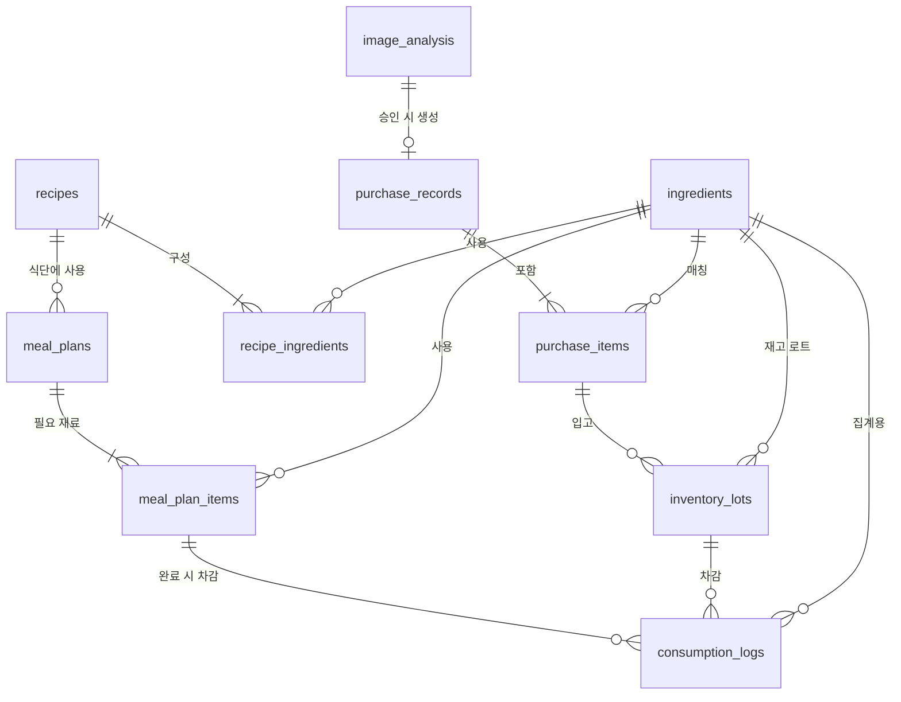
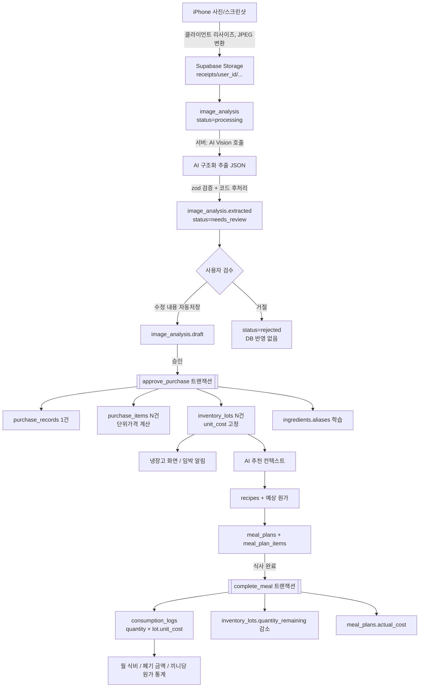

# MY KITCHEN — 설계안 v0.1

> 상태: **검토 대기** (승인 전에는 코드를 작성하지 않음)
> 범위: 폴더 구조, DB 스키마, 화면 흐름, 데이터 흐름, API, 개발 계획, 기술적 문제

---

## 0. 설계 핵심 원칙 요약

| 원칙 | 설계 반영 |
|---|---|
| 식재료 정보와 구매 건별 재고 분리 | `ingredients`(무엇인가) ↔ `inventory_lots`(언제, 얼마에, 얼마나 남았나) |
| AI는 이미지 분석과 레시피 생성만 담당 | 가격, 재고, 영양, 원가 계산은 모두 TypeScript 또는 PostgreSQL 함수 |
| AI 결과는 승인 후 반영 | `image_analysis`에 초안만 저장 → 사용자 검수 → `approve_purchase()` RPC로 한 번에 반영 |
| 확인되지 않은 소비기한은 추측 금지 | `expiry_date`는 라벨/사용자 입력일 때만 값이 들어감. "보관 권장 기간"은 별도 컬럼, 화면에도 따로 표시 |
| 재고 차감 + 비용 기록 = 트랜잭션 | `complete_meal()`, `consume_lot()` 등 PostgreSQL 함수 안에서 행 잠금(`FOR UPDATE`) 후 처리 |
| 수량 계산 오차 방지 | 모든 수량은 **기준 단위(g / ml / ea)** 로 저장, 금액은 **원(정수)** |
| 1인 사용자 + RLS | 모든 사용자 테이블에 `user_id uuid default auth.uid()`, RLS `user_id = auth.uid()` |

---

## 1. 전체 프로젝트 폴더 구조

Next.js App Router 기반, **기능(feature) 단위 모듈화**. 라우트(`app/`)는 얇게 유지하고 실제 로직은 `features/`와 `server/`에 둔다.

```
my-kitchen/
├─ public/
│  ├─ manifest.webmanifest          # PWA 매니페스트
│  ├─ icons/                        # 192, 512, maskable, apple-touch-icon(180)
│  └─ splash/                       # iOS 스플래시 이미지
├─ supabase/
│  ├─ migrations/                   # 순번별 SQL 마이그레이션 (테이블, 인덱스, RLS, 함수)
│  ├─ functions/                    # (선택) Edge Functions — 현재 계획에서는 사용 안 함
│  ├─ seed.sql                      # 개발용 샘플 데이터
│  └─ config.toml
├─ src/
│  ├─ app/
│  │  ├─ (auth)/login/              # 로그인
│  │  ├─ (main)/                    # 하단 탭바 레이아웃 그룹
│  │  │  ├─ layout.tsx              # TabBar, safe-area 처리
│  │  │  ├─ page.tsx                # 홈(오늘)
│  │  │  ├─ planner/                # 주간 식단표
│  │  │  │  ├─ page.tsx
│  │  │  │  └─ [mealId]/page.tsx    # 식사 상세 / 완료 처리
│  │  │  ├─ fridge/                 # 재고
│  │  │  │  ├─ page.tsx
│  │  │  │  ├─ [ingredientId]/page.tsx   # 식재료 상세 (로트 목록, 영양, 가격 이력)
│  │  │  │  └─ new/page.tsx         # 수동 등록
│  │  │  ├─ scan/                   # 영수증 / 주문내역 분석
│  │  │  │  ├─ page.tsx             # 업로드
│  │  │  │  ├─ [analysisId]/page.tsx  # 분석 결과 검수 & 승인
│  │  │  │  └─ history/page.tsx     # 구매 내역
│  │  │  ├─ recipes/                # AI 추천 & 저장 레시피
│  │  │  │  ├─ page.tsx
│  │  │  │  └─ [recipeId]/page.tsx
│  │  │  └─ settings/page.tsx
│  │  ├─ api/                       # Route Handlers (AI 호출, 업로드 등 서버 전용)
│  │  │  ├─ analysis/...
│  │  │  ├─ recipes/recommend/...
│  │  │  └─ ...
│  │  ├─ layout.tsx                 # 메타, viewport-fit=cover, 폰트
│  │  └─ globals.css                # Tailwind + 디자인 토큰(CSS 변수)
│  ├─ features/                     # 기능 모듈 (UI + 클라이언트 로직 + 서버 액션)
│  │  ├─ meal-planner/
│  │  │  ├─ components/             # WeekStrip, MealSlotCard, CompleteMealSheet
│  │  │  ├─ actions.ts              # Server Actions
│  │  │  ├─ queries.ts              # 조회 함수
│  │  │  └─ schema.ts               # zod 스키마
│  │  ├─ inventory/
│  │  ├─ receipt-analyzer/
│  │  │  ├─ components/             # UploadDropzone, ReviewTable, ItemEditSheet
│  │  │  ├─ matching.ts             # 상품명 → 식재료 매칭
│  │  │  └─ ...
│  │  ├─ recipes/
│  │  └─ ingredients/               # 식재료 마스터(공통)
│  ├─ server/                       # 서버 전용 (import 'server-only')
│  │  ├─ ai/
│  │  │  ├─ provider.ts             # AI 공급자 추상화 (모델 교체 가능)
│  │  │  ├─ receipt-extractor.ts    # 영수증/주문내역 → 구조화 JSON
│  │  │  ├─ recipe-generator.ts     # 재고 컨텍스트 → 레시피 JSON
│  │  │  └─ prompts/                # 프롬프트 템플릿 (버전 관리)
│  │  ├─ image/                     # 리사이즈, 긴 스크린샷 분할(sharp)
│  │  └─ supabase/                  # service-role 클라이언트 (필요 최소한)
│  ├─ lib/
│  │  ├─ supabase/                  # browser / server / middleware 클라이언트
│  │  ├─ domain/                    # ★ 순수 계산 로직 (AI 미사용, 단위 테스트 대상)
│  │  │  ├─ units.ts                # 단위 변환 (팩 → g/ml/ea)
│  │  │  ├─ pricing.ts              # 단위 가격, 할인 배분
│  │  │  ├─ nutrition.ts            # 영양 합산
│  │  │  ├─ costing.ts              # 레시피 예상 원가 (FIFO 시뮬레이션)
│  │  │  └─ expiry.ts               # 소비기한/권장기한 상태 판단
│  │  ├─ date.ts                    # Asia/Seoul 기준 주간 계산
│  │  └─ utils.ts
│  ├─ components/ui/                # 공통 UI (Button, Sheet, ListRow, Stepper, Badge, TabBar)
│  ├─ types/
│  │  └─ database.ts                # supabase gen types 결과
│  └─ middleware.ts                 # 세션 갱신, 미로그인 리다이렉트
├─ tests/
│  ├─ unit/                         # lib/domain 테스트 (Vitest)
│  ├─ db/                           # RPC 트랜잭션 테스트 (pgTAP 또는 Vitest + 로컬 Supabase)
│  └─ e2e/                          # Playwright (iPhone 뷰포트)
├─ .env.example                     # 키 이름만 기재
├─ next.config.ts
├─ tailwind.config.ts
└─ package.json
```

**모듈 경계 규칙**
- `features/*`는 서로 직접 import하지 않고 `lib/domain`, `components/ui`, DB 타입만 공유한다.
- AI SDK와 service-role 키는 `src/server/` 밖에서 import 불가 (`server-only` 패키지로 강제).
- 재고/비용을 바꾸는 쓰기 작업은 **반드시 DB 함수(RPC)** 를 통한다. 클라이언트에서 `inventory_lots`를 직접 update하지 않는다.

---

## 2. 데이터베이스 ERD 및 상세 스키마

### 2.1 ERD



**관계 요약**
- `ingredients` 1 — N `inventory_lots`: 같은 "우유"라도 구매 건마다 별도 로트(가격, 소비기한, 남은 양이 다름).
- `purchase_items` 1 — N `inventory_lots`: 보통 1:1이지만 "계란 30구를 냉장 20 / 냉동 10" 처럼 나눠 보관하면 1:N.
- `inventory_lots` 1 — N `consumption_logs`: 모든 재고 변화는 로그로 남음. **남은 수량 = 초기 수량 − Σ 소비 로그** 가 항상 성립.
- `meal_plans`(한 끼의 메뉴 하나) 1 — N `meal_plan_items`(그 메뉴에 필요한 재료).
- `image_analysis` 1 — 0..1 `purchase_records`: 승인 전에는 구매 내역이 없음.

### 2.2 공통 규칙

- PK: `id uuid default gen_random_uuid()`
- 모든 사용자 테이블: `user_id uuid not null default auth.uid() references auth.users(id) on delete cascade`
- 시간: `created_at timestamptz default now()`, `updated_at timestamptz` (트리거로 갱신)
- 금액: `integer` (원). 단위 가격만 `numeric(12,4)` (원/g 단위는 소수가 필요)
- 수량: `numeric(12,3)`, **기준 단위로 저장**
- 날짜: 식단/소비기한은 `date` (Asia/Seoul 기준 로컬 날짜)
- Enum 타입:
  - `base_unit`: `g`, `ml`, `ea`
  - `storage_location`: `fridge`(냉장), `freezer`(냉동), `pantry`(실온)
  - `meal_type`: `breakfast`, `lunch`, `dinner`, `snack`
  - `expiry_source`: `label`(포장 표기 확인), `user`(사용자 입력), `ocr`(이미지에서 읽음, 사용자 확인 완료)
  - `consumption_reason`: `meal`, `manual`, `discard`, `adjust`
  - `analysis_status`: `uploaded`, `processing`, `needs_review`, `approved`, `rejected`, `failed`
  - `purchase_source`: `receipt`, `coupang`, `online_other`, `manual`

### 2.3 테이블 상세

#### ① `ingredients` — 식재료 기본 정보 (마스터)

| 컬럼 | 타입 | 제약 / 설명 |
|---|---|---|
| id | uuid | PK |
| user_id | uuid | FK auth.users |
| name | text | not null, 표준명 (예: "대파") |
| aliases | text[] | default `{}`, 영수증 표기 별칭 (예: "흙대파 1단", "국내산 대파") — 매칭 학습용 |
| category | text | 채소/육류/수산/유제품/곡류/양념/가공식품 등 |
| base_unit | base_unit | not null, 수량 계산 기준 |
| grams_per_ea | numeric(10,3) | null 가능. `ea` 재료의 중량 환산 (계란 1개≈60g) — 영양 계산용, 사용자 입력 |
| default_storage | storage_location | 기본 보관 위치 |
| storage_days_fridge | smallint | null 가능. **보관 권장 기간**(일). 소비기한 아님 |
| storage_days_freezer | smallint | 동일 |
| storage_days_pantry | smallint | 동일 |
| nutrition_basis | text | `per_100g` / `per_100ml` / `per_ea` |
| kcal, protein_g, fat_g, carbs_g, sugar_g, fiber_g, sodium_mg | numeric(8,2) | null 가능 = "정보 없음" (0과 구분) |
| nutrition_source | text | `user`, `mfds`(식약처 DB), `label` 등. AI가 추정한 값은 저장하지 않음 |
| low_stock_threshold | numeric(12,3) | null 가능, 부족 알림 기준 |
| is_archived | boolean | default false (삭제 대신 보관 처리 — 과거 기록 보존) |

- 제약: `unique (user_id, lower(name))`, `check (grams_per_ea is null or grams_per_ea > 0)`, `check (storage_days_* is null or storage_days_* between 0 and 3650)`
- 인덱스: `(user_id, category)`, GIN `aliases`, GIN trigram `name gin_trgm_ops` (상품명 유사도 매칭용)

#### ② `image_analysis` — 이미지 분석 작업 및 결과 초안

| 컬럼 | 타입 | 제약 / 설명 |
|---|---|---|
| id | uuid | PK |
| user_id | uuid | |
| kind | purchase_source | `receipt` / `coupang` / `online_other` |
| image_paths | text[] | not null, Storage 경로 (긴 스크린샷 여러 장 지원) |
| status | analysis_status | default `uploaded` |
| model | text | 사용한 AI 모델명 |
| prompt_version | text | 프롬프트 버전 (재현/디버깅) |
| raw_response | jsonb | AI 원본 응답 (감사 추적) |
| extracted | jsonb | 스키마 검증을 통과한 추출 결과 (AI 결과 그대로) |
| draft | jsonb | 사용자가 검수 중 수정한 값 (자동 저장) |
| warnings | jsonb | 합계 불일치, 판독 불가 항목 등 코드가 계산한 경고 |
| error_message | text | 실패 사유 |
| purchase_record_id | uuid | FK purchase_records, null 가능, 승인 후 연결 |
| approved_at | timestamptz | |
| image_hash | text | 이미지 SHA-256 — 같은 영수증 중복 업로드 감지 |

- 제약: `check (status <> 'approved' or purchase_record_id is not null)`
- 인덱스: `(user_id, status, created_at desc)`, `unique (user_id, image_hash)` (중복 시 경고 후 사용자 선택)

#### ③ `purchase_records` — 구매 건 (영수증 1장 = 1건)

| 컬럼 | 타입 | 제약 / 설명 |
|---|---|---|
| id | uuid | PK |
| user_id | uuid | |
| source | purchase_source | not null |
| store_name | text | "쿠팡 프레시", "OO마트" |
| purchased_at | date | not null |
| order_number | text | null 가능, 쿠팡 주문번호 (중복 방지) |
| subtotal | integer | 상품 합계 |
| discount_total | integer | default 0, 영수증 단위 할인/쿠폰 |
| delivery_fee | integer | default 0 |
| total_paid | integer | 실결제액 |
| image_analysis_id | uuid | FK image_analysis, null 가능(수동 입력) |
| memo | text | |

- 제약: `check (total_paid >= 0)`, `unique (user_id, source, order_number) where order_number is not null`
- 인덱스: `(user_id, purchased_at desc)`

#### ④ `purchase_items` — 구매 품목

| 컬럼 | 타입 | 제약 / 설명 |
|---|---|---|
| id | uuid | PK |
| user_id | uuid | |
| purchase_record_id | uuid | FK purchase_records **on delete cascade**, not null |
| ingredient_id | uuid | FK ingredients, null 가능 (식품이 아닌 품목: 키친타월 등) |
| is_food | boolean | default true |
| raw_name | text | not null, 영수증 표기 그대로 |
| pack_count | numeric(10,3) | not null, 구매 개수 (예: 2) |
| pack_size | numeric(12,3) | 1팩 용량 (예: 900) |
| pack_unit | text | 표기 단위 (`g`, `kg`, `ml`, `L`, `개`, `구` …) |
| total_quantity | numeric(12,3) | **기준 단위 총량** (예: 2 × 900ml = 1800ml) — 코드로 계산 |
| line_price | integer | not null, 품목 표기 금액 |
| line_discount | integer | default 0, 품목 할인 |
| allocated_discount | integer | default 0, 영수증 전체 할인을 금액 비례로 배분한 값 |
| final_price | integer | generated: `line_price - line_discount - allocated_discount` |
| unit_price | numeric(12,4) | generated: `final_price / total_quantity` (원 / 기준단위) |

- 제약: `check (pack_count > 0)`, `check (line_price >= 0)`, `check (is_food = false or ingredient_id is not null)` (승인된 식품 품목은 반드시 식재료 연결)
- 인덱스: `(purchase_record_id)`, `(user_id, ingredient_id, created_at desc)` (가격 이력 조회)

#### ⑤ `inventory_lots` — 구매 건별 재고

| 컬럼 | 타입 | 제약 / 설명 |
|---|---|---|
| id | uuid | PK |
| user_id | uuid | |
| ingredient_id | uuid | FK ingredients, not null |
| purchase_item_id | uuid | FK purchase_items **on delete set null**, null = 수동 등록/선물 등 |
| storage_location | storage_location | not null |
| quantity_initial | numeric(12,3) | not null, 기준 단위 |
| quantity_remaining | numeric(12,3) | not null |
| unit_cost | numeric(12,4) | null 가능 (가격 모르는 재고), 원/기준단위 — 입고 시점 고정 |
| acquired_on | date | not null, 입고일 |
| opened_on | date | null 가능, 개봉일 |
| expiry_date | date | **null 가능. 확인된 경우에만 입력** |
| expiry_source | expiry_source | `expiry_date`가 있으면 필수 |
| recommended_use_by | date | 보관 권장 기한 = `acquired_on + storage_days_<location>` (코드 계산, 참고용) |
| status | text | `active` / `depleted` / `discarded` |
| depleted_at | timestamptz | |
| note | text | |

- 제약:
  - `check (quantity_remaining >= 0 and quantity_remaining <= quantity_initial)`
  - `check ((expiry_date is null) = (expiry_source is null))`
  - `check (status <> 'active' or quantity_remaining > 0)`
- 인덱스:
  - `(user_id, ingredient_id) where status = 'active'` — 재료별 재고 합산
  - `(user_id, expiry_date) where status = 'active'` — 임박 재료 조회
  - `(user_id, storage_location) where status = 'active'` — 탭별 목록
  - `(purchase_item_id)`

#### ⑥ `consumption_logs` — 소비 / 폐기 / 조정 기록 (원장)

| 컬럼 | 타입 | 제약 / 설명 |
|---|---|---|
| id | uuid | PK |
| user_id | uuid | |
| lot_id | uuid | FK inventory_lots, **on delete restrict**, not null |
| ingredient_id | uuid | FK ingredients, not null (집계 편의를 위한 비정규화, 트리거로 lot과 일치 검증) |
| quantity | numeric(12,3) | not null, 기준 단위. `adjust`만 음수 허용 (재고 증가 보정) |
| unit_cost | numeric(12,4) | 차감 시점 lot의 단가 복사 |
| cost | integer | `round(quantity × unit_cost)` — 원 |
| reason | consumption_reason | not null |
| meal_plan_item_id | uuid | FK meal_plan_items on delete set null, reason=`meal`일 때 필수 |
| consumed_on | date | not null |
| note | text | |

- 제약: `check (reason = 'adjust' or quantity > 0)`, `check (reason <> 'meal' or meal_plan_item_id is not null)`
- 인덱스: `(user_id, consumed_on)` (월별 식비/폐기 통계), `(lot_id)`, `(meal_plan_item_id)`, `(user_id, ingredient_id, consumed_on)`
- **이 테이블은 append-only**: 수정 대신 반대 방향 `adjust` 로그로 취소. (식사 완료 취소 = 해당 로그들의 역분개)

#### ⑦ `recipes` — 레시피 (사용자 작성 + AI 생성 저장본)

| 컬럼 | 타입 | 제약 / 설명 |
|---|---|---|
| id | uuid | PK |
| user_id | uuid | |
| title | text | not null |
| description | text | |
| source | text | `ai` / `user` |
| servings | smallint | not null, `check > 0` |
| cook_minutes | smallint | |
| steps | jsonb | `[{ "order": 1, "text": "..." }]` |
| tags | text[] | 한식, 단백질, 10분 등 |
| ai_meta | jsonb | 생성 모델, 프롬프트 버전, 추천 사유 |
| is_favorite | boolean | default false |

- 인덱스: `(user_id, created_at desc)`, GIN `tags`
- 영양/원가는 **저장하지 않고** 조회 시 `recipe_ingredients` + `ingredients` + 재고로 계산 (가격이 변하므로)

#### ⑧ `recipe_ingredients` — 레시피 구성 재료

| 컬럼 | 타입 | 제약 / 설명 |
|---|---|---|
| id | uuid | PK |
| user_id | uuid | |
| recipe_id | uuid | FK recipes **on delete cascade** |
| ingredient_id | uuid | FK ingredients, null 가능 (AI가 제안했지만 마스터에 없는 재료) |
| name_raw | text | not null, 표시용 이름 |
| quantity | numeric(12,3) | 기준 단위, null = "약간/적당량" |
| display_text | text | "대파 1/2대", "간장 1큰술" |
| is_optional | boolean | default false |
| sort_order | smallint | |

- 인덱스: `(recipe_id)`, `(user_id, ingredient_id)`

#### ⑨ `meal_plans` — 식단 (특정 날짜 · 끼니의 메뉴 1개)

| 컬럼 | 타입 | 제약 / 설명 |
|---|---|---|
| id | uuid | PK |
| user_id | uuid | |
| plan_date | date | not null |
| meal_type | meal_type | not null |
| title | text | not null, 메뉴명 |
| recipe_id | uuid | FK recipes on delete set null, null = 자유 입력 메뉴 |
| servings | numeric(4,1) | default 1 |
| status | text | `planned` / `done` / `skipped` |
| completed_at | timestamptz | |
| actual_cost | integer | 완료 시 consumption_logs 합계를 기록 (조회 성능용 스냅샷) |
| sort_order | smallint | 한 끼에 여러 메뉴 |
| memo | text | |

- 제약: `check (status <> 'done' or completed_at is not null)`
- 인덱스: `(user_id, plan_date, meal_type)` — 주간 조회는 `plan_date between 월 and 일`

#### ⑩ `meal_plan_items` — 식단에 연결된 식재료

| 컬럼 | 타입 | 제약 / 설명 |
|---|---|---|
| id | uuid | PK |
| user_id | uuid | |
| meal_plan_id | uuid | FK meal_plans **on delete cascade** |
| ingredient_id | uuid | FK ingredients, not null |
| planned_quantity | numeric(12,3) | not null, 기준 단위 (레시피 수량 × 인분 비율) |
| actual_quantity | numeric(12,3) | 완료 시 사용자가 수정한 실제 사용량 |
| preferred_lot_id | uuid | FK inventory_lots, null = FIFO 자동 선택 |
| shortage_quantity | numeric(12,3) | default 0, 재고 부족분 기록 |

- 제약: `check (planned_quantity > 0)`, `unique (meal_plan_id, ingredient_id)`
- 인덱스: `(meal_plan_id)`, `(user_id, ingredient_id)` — "이번 주 식단에 예약된 양" 계산

### 2.4 RLS 정책

모든 10개 테이블에 동일 패턴 적용:

- `alter table ... enable row level security`
- `select / insert / update / delete` 정책: `using (user_id = auth.uid())`, `with check (user_id = auth.uid())`
- **부모-자식 소유권 일치 보장**: `user_id`만 맞으면 다른 사용자 lot을 참조하는 행을 만들 수 있는 허점이 있으므로,
  - 주요 FK는 `(parent_id, user_id) → parent(id, user_id)` **복합 외래키**로 선언 (부모에 `unique (id, user_id)` 추가)
  - 1인 앱이라 실제 위험은 낮지만, 설계 단계에서 막아두면 이후 공유 기능 확장 시에도 안전
- `consumption_logs`, `inventory_lots.quantity_remaining`: 클라이언트 직접 update 금지 → update 정책을 열지 않고 `security definer` 함수(내부에서 `auth.uid()` 검증)로만 변경
- Storage 버킷 `receipts`: private, 경로 규칙 `{user_id}/{yyyy}/{uuid}.jpg`, 정책 `(storage.foldername(name))[1] = auth.uid()::text`
- 회원가입 비활성화 + 허용 이메일 1개만 로그인 (1인 전용)

### 2.5 보조 뷰 / DB 함수

| 이름 | 종류 | 역할 |
|---|---|---|
| `v_ingredient_stock` | view | 재료별 활성 재고 합계, 가장 빠른 소비기한, 가중평균 단가, 보관 위치별 합계 |
| `v_expiring_lots` | view | `expiry_date` 또는 `recommended_use_by` 기준 D-3 이내 로트 (두 기준을 구분해서 반환) |
| `v_weekly_reserved` | view | 이번 주 미완료 식단이 예약한 재료량 → "가용 재고 = 재고 − 예약량" |
| `approve_purchase(analysis_id, payload)` | function | 구매 내역 + 품목 + 로트 생성, 별칭 학습, 분석 상태 변경 (단일 트랜잭션) |
| `complete_meal(meal_plan_id, overrides, allow_shortage)` | function | FIFO 차감, 소비 로그, 원가 기록, 상태 변경 |
| `undo_meal_completion(meal_plan_id)` | function | 역분개 로그로 재고 복원 |
| `consume_lot(lot_id, qty, reason, note)` | function | 수동 사용 / 폐기 |
| `move_lot(lot_id, qty, to_location)` | function | 냉장 → 냉동 이동 (분할 시 새 로트 생성, 단가 유지, 권장기한 재계산) |

---

## 3. 화면 구성과 사용자 이동 경로

### 3.1 내비게이션 구조

하단 탭바 5개 (엄지 영역). 가운데는 가장 자주 쓰는 "추가" 동작.

```
┌──────────────────────────────────────────────┐
│  [홈]   [식단]   ( + 스캔 )   [냉장고]   [추천]  │
└──────────────────────────────────────────────┘
```

- 주요 버튼(저장, 승인, 완료)은 **화면 하단 고정 바**에 배치 → 한 손 조작
- 편집은 페이지 이동 대신 **바텀 시트**를 우선 사용 (맥락 유지)
- 상단에는 제목과 보조 동작만 (설정 아이콘 등)

### 3.2 화면별 구성

**① 홈 (오늘)** `/`
- 오늘 날짜, 아침/점심/저녁 카드 (메뉴, 상태, `완료` 버튼)
- "곧 소비기한" 섹션: 확인된 소비기한 D-3 이내 (진한 표시) / 보관 권장기한 지남 (연한 표시, "권장" 라벨)
- 이번 달 식비, 폐기 금액 요약 (숫자 2개만)
- 분석 대기 중인 영수증 배너 (`needs_review` 상태가 있을 때만)

**② 주간 식단표** `/planner?week=2026-11-02`
- 상단: 주 이동(◀ ▶) + 월~일 가로 스트립 (오늘 강조)
- 본문: 선택한 날짜의 아침/점심/저녁 슬롯 리스트 (모바일에서 7×3 표는 가독성이 떨어지므로 **일 단위 세로 리스트 + 주간 스트립** 방식)
- 보조 보기: 주간 전체 요약(작은 표) 토글
- 슬롯 탭 → 메뉴 추가 시트: [저장 레시피에서] [AI 추천에서] [직접 입력]
- 하단: 이번 주 예상 식비 / 부족 재료 수

**③ 식사 상세** `/planner/[mealId]`
- 메뉴명, 인분, 연결 레시피
- 재료 목록: 필요량 / 보유량 / 사용 예정 로트 (FIFO, 소비기한 빠른 것 우선)
- 하단 고정 `식사 완료` → 확인 시트 (실제 사용량 수정 가능, 부족 재료 경고) → 완료 후 실제 원가 표시

**④ 냉장고** `/fridge`
- 세그먼트: [냉장] [냉동] [실온] [전체]
- 정렬: 소비기한 임박순(기본) / 카테고리 / 최근 구매
- 리스트 행: 재료명 · 총 수량 · 가장 빠른 기한 배지 · (로트 2개 이상이면 "2건")
- 검색창 (상단 고정)
- 행 스와이프/롱프레스: 사용, 폐기, 이동

**⑤ 식재료 상세** `/fridge/[ingredientId]`
- 로트 목록 (구매일, 남은 양, 단가, 소비기한/권장기한, 보관 위치)
- 영양 정보 (100g 기준) — 없으면 "정보 없음" + 입력 버튼
- 가격 이력 (구매 건별 단위 가격, 100g당 원) — 간단한 리스트, 필요 시 작은 선 그래프
- 보관 권장 기간 설정

**⑥ 스캔(업로드)** `/scan`
- 유형 선택: [영수증] [쿠팡 프레시 주문내역] [기타 온라인]
- [카메라로 촬영] [사진 보관함에서 선택] (여러 장 선택 가능, 긴 스크린샷 지원)
- 업로드 → 분석 진행 표시 (단계: 업로드 중 → 분석 중 → 검수 대기)
- 분석은 백그라운드로 진행되므로 화면을 벗어나도 됨 (홈 배너로 복귀)

**⑦ 분석 검수** `/scan/[analysisId]` ★ 핵심 화면
- 상단: 원본 이미지 썸네일 (탭하면 확대, 품목과 대조)
- 구매 정보: 매장, 구매일, 결제 합계 (수정 가능)
- **합계 검증 배지**: "품목 합계 31,200원 = 결제 금액 31,200원 ✓" 또는 "불일치 1,500원" 경고
- 품목 카드 리스트, 각 카드:
  - 영수증 표기명 → **연결 식재료** (자동 매칭 결과 + 신뢰도, 탭하면 변경/신규 생성)
  - 수량 × 용량 (예: 2 × 900ml) → 총량 1,800ml
  - 금액, 할인 → 단위 가격 (예: 100ml당 172원) **(코드 계산)**
  - 보관 위치 (재료 기본값으로 자동 선택)
  - 소비기한: 기본 **비어 있음**. "직접 입력" 버튼. 이미지에서 읽힌 경우에만 값 + "이미지에서 읽음, 확인 필요" 표시
  - 식품 아님 토글 (재고 미등록, 구매 금액만 기록)
- 하단 고정: [거절] [승인 및 재고 등록 (n개)]
- 미매칭 품목이 있으면 승인 버튼 비활성 + 해당 카드로 스크롤

**⑧ 구매 내역** `/scan/history`
- 월별 구매 건 리스트 → 상세 (품목, 단위가격, 연결된 로트 현황 "남음 / 사용 / 폐기")

**⑨ 레시피 추천** `/recipes`
- 추천 조건 칩: [임박 재료 우선] [가성비] [고단백] [15분 이내] + 인분
- `추천 받기` → 카드 3~5개: 메뉴명, 사용 재료(보유 ✓ / 부족 ✕), **예상 원가(코드 계산)**, 영양 요약, 임박 재료 사용 표시
- 저장한 레시피 탭

**⑩ 레시피 상세** `/recipes/[recipeId]`
- 재료(보유량 대비), 조리 순서, 예상 원가, 1인분 영양
- 하단 고정: [식단에 추가] → 날짜·끼니 선택 시트 → `meal_plans` + `meal_plan_items` 생성

**⑪ 설정** `/settings`
- 식재료 마스터 관리 (이름, 별칭, 보관기간, 영양)
- 임박 기준일(D-3 등), 주 시작 요일(월)
- 데이터 내보내기(CSV), 로그아웃

### 3.3 주요 사용자 이동 경로

```
[구매 후 등록]
홈 → (+스캔) → 유형 선택 → 촬영/선택 → 분석 대기
   → (알림 배너) → 검수 화면 → 품목 수정/매칭 → 승인
   → 냉장고 (새 로트 하이라이트)

[식단 계획]
식단 → 날짜 선택 → 슬롯 탭 → "AI 추천에서" → 추천 카드 → 레시피 상세
   → 식단에 추가 → 식단 (재료 부족 표시 확인)

[식사 완료]
홈 → 오늘 점심 카드 [완료] → 확인 시트(사용량 조정) → 완료
   → 재고 자동 차감, 실제 원가 표시

[임박 재료 처리]
홈 "곧 소비기한" → 재료 탭 → [이 재료로 추천] → 추천 결과 → 식단 추가
                              └→ [폐기] → 폐기 기록(금액 집계)
```

### 3.4 디자인 토큰 (초안)

| 토큰 | 값 | 용도 |
|---|---|---|
| `--bg` | `#FFFFFF` | 기본 배경 |
| `--bg-subtle` | `#F6F7F6` | 섹션 배경 (살짝 쿨한 라이트 그레이, 노란기 없음) |
| `--line` | `#E4E7E4` | 구분선, 카드 테두리 |
| `--text` | `#1E2320` | 본문 |
| `--text-sub` | `#6A716C` | 보조 텍스트 |
| `--green` | `#4F7A5A` | 주요 동작, 선택 상태 (채도 낮은 자연 그린) |
| `--green-soft` | `#EAF1EC` | 선택 배경, 보유 표시 |
| `--warn` | `#B9832F` | 기한 임박 (D-3) |
| `--danger` | `#B85C45` | 기한 지남, 폐기 |

- 폰트: Pretendard (한글 가독성), 본문 16px (iOS 입력 확대 방지), 숫자 `tabular-nums`
- 간격: 4px 그리드, 화면 좌우 여백 20px, 터치 영역 최소 44×44px
- 그림자 대신 1px 라인, 둥근 모서리 12px, 아이콘은 1.5px 라인 아이콘 한 세트
- 애니메이션: 바텀 시트 열고 닫기, 탭 전환 정도만 (150~200ms), `prefers-reduced-motion` 존중
- 다크 모드: 2차 단계에서 토큰만 추가

---

## 4. 주요 기능별 데이터 흐름

### 4.1 ★ 이미지 분석 → 구매 내역 → 재고 → 식단 → 원가 (전체 연결)



#### 단계별 상세

**Step 1. 업로드 (클라이언트)**
1. 사용자가 유형(영수증/쿠팡)을 선택하고 이미지를 고른다.
2. 브라우저에서 HEIC → JPEG 변환 및 긴 변 2,000px 리사이즈 (긴 스크린샷은 폭 기준 리사이즈).
3. 서버가 발급한 서명 업로드 URL로 Storage에 직접 업로드 (Vercel 요청 크기 제한 회피).
4. `POST /api/analysis` → `image_analysis` 행 생성(`processing`), 이미지 해시로 중복 검사.

**Step 2. AI 추출 (서버)**
1. 서버가 Storage에서 이미지를 읽어 AI Vision API에 전달. 세로로 긴 쿠팡 캡처는 겹침을 두고 분할해 여러 장으로 전달.
2. AI에게는 **"보이는 글자만 추출, 계산·추측 금지"** 를 지시하고 JSON 스키마(도구 호출/구조화 출력)로 강제:
   ```
   store_name, purchased_at, order_number, items[]: {
     raw_name, pack_count, pack_size, pack_unit,
     line_price, line_discount, expiry_text(보이는 경우만, 없으면 null),
     confidence, bbox(선택)
   }, subtotal, discount_total, delivery_fee, total_paid
   ```
3. 응답을 zod로 검증 → 실패 시 1회 재시도 → 그래도 실패 시 `failed` + 수동 입력으로 전환.

**Step 3. 코드 후처리 (AI 미사용)**
- **단위 정규화**: `kg→g ×1000`, `L→ml ×1000`, `구/개/입→ea`. `total_quantity = pack_count × pack_size(환산)`.
  - 용량 표기가 없으면 (예: "대파 1단") `total_quantity` 비움 → 검수 화면에서 입력 요구.
- **식재료 매칭** (우선순위):
  1. `aliases`에 정확히 일치 → 신뢰도 높음 (이전 승인 기록에서 학습된 값)
  2. 정규화된 이름(브랜드·괄호·용량 제거)과 `name` 일치
  3. `pg_trgm similarity > 0.4` 상위 3개 후보 → 사용자 선택
  4. 후보 없음 → "새 식재료 만들기" (이름, 단위, 카테고리 미리 채움)
- **합계 검증**: `Σ(line_price − line_discount) − discount_total + delivery_fee` 와 `total_paid` 비교 → 불일치 시 경고.
- **할인 배분**: 영수증 전체 할인(쿠폰 등)을 식품 품목 금액 비율로 배분, 반올림 오차는 가장 큰 품목에 귀속 → 합계가 원 단위로 정확히 일치.
- **단위 가격**: `unit_price = final_price / total_quantity` (원/g). 화면에는 100g·100ml·1개당 가격으로 표시.
- **소비기한**: `expiry_text`가 있고 날짜로 파싱되는 경우에만 초안에 넣고 `expiry_source='ocr'` + "확인 필요" 표시. 없으면 null. **카테고리 평균 등으로 채우지 않는다.**
- **보관 권장 기한**: 재료 마스터의 `storage_days_*`가 설정돼 있을 때만 `acquired_on + n일` 계산. 별도 라벨로 표시.

**Step 4. 검수 (사용자)**
- 수정할 때마다 `PATCH /api/analysis/[id]` 로 `draft`에 저장 (중간에 앱을 닫아도 유지).
- 수정 시 단위가격, 합계 검증은 클라이언트에서 즉시 재계산 (`lib/domain` 공용 함수).

**Step 5. 승인 = `approve_purchase()` 단일 트랜잭션**
1. `image_analysis`를 `FOR UPDATE`로 잠그고 상태가 `needs_review`인지 확인 (이중 승인 방지).
2. 서버에서 payload를 다시 검증·재계산 (클라이언트 계산값을 신뢰하지 않음).
3. 신규 식재료 생성 → `purchase_records` → `purchase_items` (식품 아님 포함) 순서로 삽입.
4. 식품 품목마다 `inventory_lots` 생성: `quantity_initial = quantity_remaining = total_quantity`, `unit_cost = purchase_items.unit_price`, `acquired_on = purchased_at`, `expiry_date`(확인된 값만), `recommended_use_by`.
5. `raw_name`을 해당 식재료 `aliases`에 추가 (다음 분석부터 자동 매칭).
6. `image_analysis.status = approved`, `purchase_record_id` 연결.
7. 어느 단계든 실패하면 전체 롤백 → 검수 화면에 오류 표시, `draft`는 유지.

**Step 6. 재고 → 식단 → 원가**
- 재고 화면과 추천은 `v_ingredient_stock` 을 읽는다. 로트별 단가가 다르므로 재료의 "현재 가치"는 가중평균으로 계산.
- 레시피 예상 원가 (`lib/domain/costing.ts`):
  - 재료마다 필요량을 **FIFO(소비기한 빠른 순 → 입고일 순)로 로트에 가상 배분**하고 `Σ 배분량 × lot.unit_cost`.
  - 재고 부족분은 **최근 구매 단위가격**(`purchase_items` 최신값)으로 계산하고 "추정"으로 표시.
  - 가격 정보가 아예 없으면 "가격 정보 없음"으로 표시하고 합계에 "일부 제외" 표기.
- 식사 완료 시 실제 차감된 로트 단가로 **실제 원가** 확정 → `consumption_logs.cost` 합 = `meal_plans.actual_cost`.
- 결과적으로 **"이 끼니에 쓴 우유 200ml는 11월 2일 쿠팡 주문(100ml당 172원)에서 나왔다"** 까지 추적 가능.

### 4.2 식사 완료 (재고 차감 트랜잭션) — `complete_meal()`

```
입력: meal_plan_id, overrides[{ingredient_id, actual_quantity, lot_id?}], allow_shortage
1. meal_plans 행 FOR UPDATE, status='planned' 확인 (중복 완료 방지)
2. 각 meal_plan_item에 대해
   a. 사용량 = override ?? planned_quantity
   b. 대상 로트 조회: preferred_lot_id 우선, 그 외 active 로트를
      (expiry_date nulls last, recommended_use_by nulls last, acquired_on) 순서로 FOR UPDATE
   c. 남은 사용량이 0이 될 때까지 로트별로
      - take = min(남은 사용량, lot.quantity_remaining)
      - lot.quantity_remaining -= take (0이면 status='depleted')
      - consumption_logs insert (reason='meal', unit_cost, cost)
   d. 부족분이 남으면: allow_shortage=false → 전체 롤백 후 부족 목록 반환
                      allow_shortage=true  → shortage_quantity 기록
3. meal_plans.status='done', completed_at, actual_cost = Σ cost
4. commit
```
- 취소: `undo_meal_completion()` 이 해당 로그들과 반대 수량의 `adjust` 로그를 쓰고 로트를 복원 (기록은 지우지 않음).

### 4.3 수동 재고 조작
- 사용/폐기: `consume_lot()` → 로그 + 차감. 폐기는 `reason='discard'` 로 "버린 금액" 집계.
- 수량 보정(실사): `reason='adjust'`.
- 보관 위치 이동: `move_lot()` — 일부만 이동하면 원 로트 차감 + 새 로트 생성(같은 `purchase_item_id`, 같은 단가). 냉동 이동 시 권장기한은 냉동 기준으로 재계산, **확인된 소비기한은 그대로 유지**.
- 수동 등록 (선물, 텃밭 등): `purchase_item_id = null`, `unit_cost` 선택 입력.

### 4.4 AI 레시피 추천

```
1. 서버가 컨텍스트 생성 (코드):
   - 가용 재고 = 활성 재고 − 이번 주 예약량 (재료명, 수량, 단위)
   - 임박 재료 목록 (확인된 소비기한 D-3 / 권장기한 경과를 구분)
   - 재료별 단위가격 (가성비 판단용)
   - 사용자 조건 (인분, 시간, 영양 목표), 최근 7일 식단(중복 회피)
2. AI 호출: JSON 스키마 강제
   recipes[]: { title, servings, cook_minutes, ingredients[]{name, quantity, unit, optional},
                steps[], uses_expiring[], reason }
   - AI가 쓰는 재료명은 컨텍스트로 준 재료명에서 고르도록 지시 → 매칭 정확도 확보
   - 원가·영양 수치는 AI에게 요구하지 않음
3. 코드 후처리:
   - 재료명 → ingredient_id 매칭, 단위를 기준 단위로 변환 ("1큰술" 등은 환산표, 실패 시 quantity=null)
   - 보유 여부, 예상 원가(FIFO 시뮬레이션), 영양 합계(ingredients 영양 × 수량) 계산
   - 정렬 점수 = 임박재료 사용 가중치 + 보유율 + (1/원가) + 영양 조건 충족 (가중치는 설정 가능)
4. 화면 표시 → [저장] 시 recipes/recipe_ingredients insert
   → [식단에 추가] 시 meal_plans + meal_plan_items(수량 × 인분 비율)
```
- 추천 결과는 저장 전까지 DB에 쓰지 않음 (임시 결과는 클라이언트 상태 또는 짧은 캐시).

### 4.5 영양 계산
- `ingredients`의 기준(`per_100g`/`per_100ml`/`per_ea`)과 수량으로 계산. `ea` 재료를 g 기준 영양으로 계산할 땐 `grams_per_ea` 필요.
- 영양값이 null인 재료는 합계에서 제외하고 "n개 재료 영양 정보 없음" 표시 (0으로 처리하지 않음).
- 영양 데이터 출처: 사용자 입력, 포장 라벨, 식품의약품안전처 식품영양성분 DB(공공 API, 2차 단계). AI가 추정한 수치는 저장하지 않음.

---

## 5. API 목록

조회는 Server Component에서 Supabase(사용자 세션 + RLS)로 직접 읽고, **AI 호출과 재고/비용 변경**은 서버(Route Handler / Server Action → DB 함수)를 거친다.

### 5.1 Route Handlers (`/api`)

| Method | Path | 설명 | 비고 |
|---|---|---|---|
| POST | `/api/uploads/sign` | Storage 서명 업로드 URL 발급 | 경로에 user_id 강제 |
| POST | `/api/analysis` | 분석 작업 생성 + AI 추출 실행 | `maxDuration` 확장, 처리 후 `needs_review` |
| GET | `/api/analysis/[id]` | 상태·결과 조회 (폴링용) | |
| PATCH | `/api/analysis/[id]` | 검수 중 `draft` 저장 | |
| POST | `/api/analysis/[id]/retry` | 실패/불만족 시 재분석 | |
| POST | `/api/analysis/[id]/approve` | 서버 재검증 → `approve_purchase` RPC | 멱등 (이미 승인 시 기존 결과 반환) |
| POST | `/api/analysis/[id]/reject` | 거절 | |
| GET | `/api/ingredients/match?q=` | 상품명 → 식재료 후보 (trigram) | |
| POST | `/api/recipes/recommend` | AI 레시피 추천 + 원가/영양 계산 | 요청 빈도 제한 |
| POST | `/api/meal-plans/[id]/complete` | `complete_meal` RPC | 부족 시 409 + 부족 목록 |
| POST | `/api/meal-plans/[id]/undo` | `undo_meal_completion` RPC | |
| POST | `/api/lots/[id]/consume` | 사용/폐기/보정 | |
| POST | `/api/lots/[id]/move` | 보관 위치 이동 | |
| GET | `/api/export?type=` | CSV 내보내기 | |

### 5.2 Server Actions (단순 CRUD, RLS로 보호)

| 영역 | 동작 |
|---|---|
| ingredients | 생성, 수정(별칭·보관기간·영양), 보관 처리 |
| inventory | 수동 로트 생성, 메모·소비기한 수정 (수량 변경은 RPC만) |
| purchases | 수동 구매 입력 (→ 내부적으로 `approve_purchase`와 같은 함수 재사용) |
| meal_plans | 생성, 수정, 이동(날짜/끼니), 삭제(미완료만), 재료 연결 수정 |
| recipes | 저장, 수정, 즐겨찾기, 삭제 |

### 5.3 DB 함수 (RPC)
`approve_purchase`, `complete_meal`, `undo_meal_completion`, `consume_lot`, `move_lot` — 2.5절 참고. 모두 `security definer` + 내부 `auth.uid()` 소유권 검증 + `search_path` 고정.

### 5.4 외부 API
- **AI Vision / LLM**: 서버에서만 호출. 공급자 추상화(`server/ai/provider.ts`)로 모델 교체 가능하게 구성. 기본안은 Claude API(이미지 입력 + 구조화 출력 지원)이며, 영수증 추출은 속도·비용 균형형 모델, 레시피 생성도 같은 모델로 시작 후 품질 보고 조정.
- **식약처 식품영양성분 DB** (2차, 선택)

### 5.5 환경 변수 (서버 전용, `.env.example`에는 이름만)
`NEXT_PUBLIC_SUPABASE_URL`, `NEXT_PUBLIC_SUPABASE_ANON_KEY`(공개 가능), `SUPABASE_SERVICE_ROLE_KEY`(서버 전용, 최소 사용), `AI_API_KEY`, `AI_MODEL_VISION`, `AI_MODEL_TEXT`, `ALLOWED_EMAIL`

---

## 6. 개발 단계별 구현 계획

| 단계 | 목표 | 주요 작업 | 완료 기준 |
|---|---|---|---|
| **0. 기반** | 뼈대 | Next.js + TS + Tailwind 세팅, 디자인 토큰, 공통 UI(TabBar, Sheet, ListRow, Button), Supabase 연결, 로그인(허용 이메일 1개), PWA 매니페스트·아이콘, Vercel 배포 | iPhone 홈 화면에 추가 → 로그인 → 빈 탭 이동 |
| **1. DB** | 데이터 기반 | 마이그레이션(enum, 10개 테이블, 인덱스, RLS, 복합 FK), 뷰, 타입 생성, `lib/domain` 단위 변환·가격 함수 + 단위 테스트 | 로컬 Supabase에서 RLS 테스트 통과 |
| **2. 재고** | 수동으로라도 쓸 수 있는 앱 | 식재료 마스터 CRUD, 수동 로트 등록, 냉장/냉동/실온 목록, 상세, `consume_lot`, `move_lot`, 임박 표시 | 재료 등록 → 사용/폐기 → 로그·수량 일치 |
| **3. 영수증 분석** | 핵심 차별 기능 | 업로드(HEIC 변환, 서명 URL), AI 추출 + zod, 후처리(단위·매칭·할인 배분·합계 검증), 검수 화면, `approve_purchase`, 구매 내역 | 실제 영수증 10장·쿠팡 캡처 5장으로 승인까지 정상 처리, 합계 일치 |
| **4. 식단** | 계획과 소비 연결 | 주간 스트립 + 일별 슬롯, 메뉴 추가(자유 입력/레시피), 재료 연결, `complete_meal`/`undo`, 홈 화면 | 완료 → 재고 차감 → 실제 원가 표시, 동시 실행 테스트 통과 |
| **5. AI 추천** | 재고 기반 추천 | 컨텍스트 생성, 추천 API, 원가·영양·점수 계산, 레시피 저장, 식단에 추가 | 임박 재료가 추천에 반영되고 원가가 로트 단가와 일치 |
| **6. 다듬기** | 일상 사용 품질 | 통계(월 식비, 폐기 금액, 끼니당 원가), 영양 DB 연동, 오프라인 읽기 캐시, CSV 내보내기, 다크 모드, 성능 점검 | 2주간 실사용 후 개선 목록 반영 |

- 단계 2가 끝나면 AI 없이도 사용 가능한 상태 → 이후 AI 기능은 **입력을 빠르게 해주는 보조 수단**으로 얹는 구조.
- 각 단계 끝에 Playwright iPhone 뷰포트 E2E 1개 이상 추가.

---

## 7. 예상되는 기술적 문제와 해결 방법

| # | 문제 | 해결 방법 |
|---|---|---|
| 1 | **단위 불일치** ("대파 1단", "두부 1모", "간장 1큰술") | 기준 단위 3종(g/ml/ea)만 저장. 표기 단위 → 기준 단위 환산표를 `lib/domain/units.ts`에 두고, 환산 불가 시 검수 화면에서 사용자 입력 요구. 재료별로 `ea` 기준 관리도 허용 (대파는 "대" 단위로 ea) |
| 2 | **영수증 상품명이 축약·잘림** ("국산깐마늘1") | 별칭 학습(`aliases`) + trigram 유사도 후보 + 최종 사용자 선택. 승인할수록 자동 매칭률 상승 |
| 3 | **AI 오인식 (숫자, 가격)** | 합계 검증으로 자동 감지, 원본 이미지 대조 UI, 저신뢰 항목 강조. AI는 추출만 하고 계산은 코드가 하므로 계산 오류는 발생하지 않음 |
| 4 | **영수증 단위 할인/쿠폰 처리** | 금액 비례 배분 + 반올림 잔차를 최대 금액 품목에 귀속 → 품목 합계 = 실결제액(배송비 제외) 정확히 일치. 배송비는 품목 원가에 넣지 않고 구매 건에만 기록 (설정으로 포함 여부 선택 가능) |
| 5 | **쿠팡 긴 스크린샷 / 여러 장** | 서버에서 sharp로 겹침(예: 200px) 분할 → 각 조각 추출 → 품목 중복 제거(이름+가격+인접 위치). 다중 이미지 1건으로 묶음 (`image_paths[]`) |
| 6 | **iPhone HEIC, 대용량 사진** | 클라이언트에서 canvas로 JPEG 변환·리사이즈(iOS Safari는 HEIC 디코딩 지원), 실패 시 서버 sharp 변환. 서명 URL 직접 업로드로 Vercel 본문 크기 제한 회피 |
| 7 | **AI 응답 지연 → 서버리스 타임아웃** | Route Handler `maxDuration` 확장 + 클라이언트는 상태 폴링(또는 Supabase Realtime 구독). 처리 중 앱을 닫아도 결과는 DB에 남음 |
| 8 | **소비기한 추측 위험** | `expiry_date`와 `recommended_use_by`를 컬럼·UI 모두 분리. 확인된 값만 `expiry_date`(출처 필수, DB 제약으로 강제). 권장기한은 사용자가 재료 마스터에 설정한 값으로만 계산 |
| 9 | **동시 실행으로 재고 음수/이중 차감** (두 기기에서 동시 완료, 더블 탭) | DB 함수 안에서 `FOR UPDATE` 행 잠금 + 상태 확인, `check (quantity_remaining >= 0)` 최종 방어선, 버튼 중복 클릭 방지, 승인 API 멱등 처리 |
| 10 | **재고 수치와 기록 불일치** | 수량 변경은 RPC만 허용(직접 update 정책 없음), 소비 로그 append-only, 정기 검증 쿼리(`initial − Σlog = remaining`)로 테스트 |
| 11 | **소수점 오차** | 수량 `numeric`, 금액은 정수 원, 단위가격만 `numeric(12,4)`. JS 쪽 계산은 정수/고정소수 처리 후 표시 시에만 반올림 |
| 12 | **냉동 이동 시 기한 처리** | 확인된 소비기한은 유지, 권장기한만 냉동 기준으로 재계산. 부분 이동은 로트 분할(단가·출처 유지) |
| 13 | **식재료 삭제 시 과거 기록 깨짐** | 삭제 대신 `is_archived`. FK는 `restrict`/`set null`로 원장 보존 |
| 14 | **AI가 마스터에 없는 재료로 레시피 생성** | 프롬프트에 보유 재료명 목록 제공 + 결과 매칭. 미보유 재료는 `ingredient_id = null`로 저장하고 "구매 필요"로 표시, 원가는 최근 구매가 또는 "정보 없음" |
| 15 | **API 키 노출** | AI 호출은 서버 전용 모듈(`server-only`), 키는 Vercel 환경변수. service-role 키는 꼭 필요한 곳만, 일반 요청은 사용자 세션 + RLS |
| 16 | **AI 호출 비용/남용** | 이미지 해시 중복 분석 방지, 리사이즈로 토큰 절감, 추천 API 빈도 제한, 실패 재시도 1회 제한, 모델명 환경변수로 교체 가능 |
| 17 | **PWA on iOS 제약** (Safe area, 키보드, 푸시) | `viewport-fit=cover` + `env(safe-area-inset-*)`, 입력 16px, 하단 고정 바는 키보드 표시 시 숨김. 웹 푸시는 iOS 16.4+ 홈 화면 앱만 가능하므로 임박 알림은 1차에 앱 내 표시, 푸시는 6단계 선택 기능 |
| 18 | **날짜/주간 경계 (UTC vs KST)** | 식단·기한은 `date` 타입으로 KST 로컬 날짜 저장, 주 시작은 월요일, 날짜 계산은 `lib/date.ts`에서 `Asia/Seoul` 고정 |
| 19 | **오프라인 / 마트에서 전파 약함** | 서비스 워커로 앱 셸 + 최근 재고 목록 읽기 캐시. 쓰기는 온라인 전용(재고 정확성 우선) |
| 20 | **AI 프롬프트 변경 시 품질 회귀** | 프롬프트 버전 관리(`prompt_version` 저장), 실제 영수증 샘플 세트로 추출 정확도 회귀 테스트 |

---

## 승인 요청 사항

다음 항목을 확인해 주시면 1단계(기반 + DB)부터 구현을 시작하겠습니다.

1. **식단 구조**: `meal_plans` = "날짜·끼니의 메뉴 1개", `meal_plan_items` = "그 메뉴에 필요한 재료"로 해석했습니다. 한 끼에 여러 메뉴(밥 + 국 + 반찬)를 등록할 수 있습니다. 괜찮으신가요?
2. **간식(snack) 끼니** 추가 여부 (현재 enum에 포함, 화면에서는 숨김 가능)
3. **배송비**를 품목 원가에 배분할지, 구매 건에만 기록할지 (기본안: 구매 건에만 기록)
4. **AI 공급자**: 기본안은 Claude API (공급자 추상화로 교체 가능). 다른 공급자를 원하시면 알려 주세요.
5. **재고 부족 시 식사 완료**: 기본안은 "부족 경고 후 사용자가 확인하면 부족분만 기록하고 완료"
6. **주간 식단표 형태**: 모바일 가독성을 위해 "주간 스트립 + 하루 단위 세로 리스트"를 기본으로 하고 7×3 표는 요약 보기로 제공
